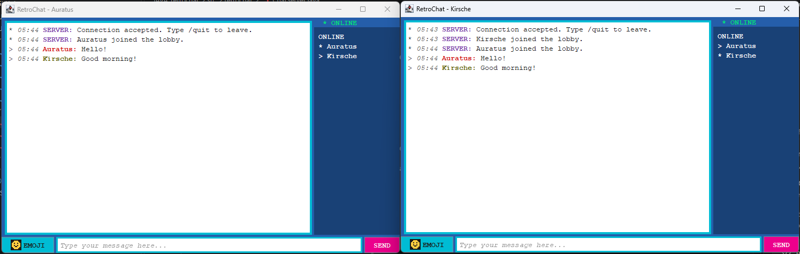
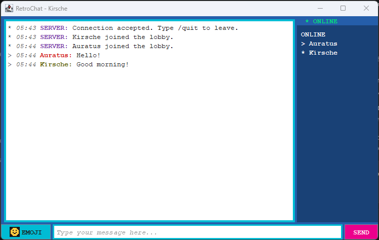

# RetroChat

**A shared chatroom with a 2000s desktop-chat feel.**

Built with Java Swing and TCP sockets, RetroChat brings multiple clients into one lobby with a bold NES-inspired palette, monospaced text, and hand-drawn pixel emoji.

**Java 11+** | **Swing desktop UI** | **TCP port 5050** | **No external libraries**

[Preview](#preview) · [Features](#features) · [Quick start](#quick-start) · [Pixel emoji](#pixel-emoji) · [Troubleshooting](#troubleshooting)

## Preview



*Two clients, one lobby: messages appear in both windows, alongside the live online-user list.*

<details>
<summary><strong>A closer look at the chat window</strong></summary>



*Cyan borders, a blue sidebar, a pink SEND button, and a pixel emoji button complete the retro look.*

</details>

## Features

| Feature | What it does |
| --- | --- |
| Shared lobby | One server broadcasts messages to all connected clients. Open multiple clients to chat or test locally. |
| Live online list | Shows connected usernames, updates when users join or leave, and marks your own name with `*`. |
| Styled conversations | Displays `HH:mm` timestamps, colored usernames, and distinct server notices. |
| Pixel emoji | Includes six custom pixel icons, a visual picker, and typed shortcodes. |
| Simple message controls | Send with **Enter** or **SEND**; blank messages are ignored. |
| Join and leave notices | Announces arrivals and departures in the conversation. |
| Connection prompts | Asks for your username, server host, and port when the client starts. |
| Retro desktop styling | Uses monospaced text, NES-inspired colors, bold borders, and a scrollable transcript. |
| Lightweight setup | Uses Java's standard library; no Maven, Gradle, or downloaded image assets are needed. |

## Quick start

### 1. Check Java

Install a **JDK 11 or newer** so both the runtime and compiler are available. The project has also been compiled with JDK 21.

```text
java -version
javac -version
```

If you just installed Java or changed PATH, fully close and reopen VS Code before opening a new terminal.

### 2. Compile and start the server

Open a terminal **inside the `JAVA_retrochat` folder**. If you are in its parent `GitHub` folder, run `cd JAVA_retrochat` first.

**PowerShell**

```powershell
javac -d out src\retrochat\*.java
java -cp out retrochat.ChatServer
```

**Git Bash**

```bash
javac -d out src/retrochat/*.java
java -cp out retrochat.ChatServer
```

Keep this terminal running. The server runs in the console; the client opens the chat window. Start only one server on port `5050`.

### 3. Open a client

Open another terminal inside `JAVA_retrochat` and run:

```text
java -cp out retrochat.RetroChatClient
```

| Prompt | Value for a local test |
| --- | --- |
| Username | Choose a name, such as `Auratus` or `Kirsche`. |
| Server host | `localhost` |
| Server port | `5050` |

Repeat this step in another terminal to open a second client. Both clients should appear in the online list and receive each other's messages.

For clients on another computer, enter the server computer's reachable hostname or IP address instead of `localhost`. The server listens on port `5050`.

### 4. Chat and exit

- Type a message and press **Enter** or click **SEND**.
- Click **EMOJI** to insert a pixel emoji code into your draft.
- Send `/quit` or close the client window to leave.
- Press **Ctrl+C** in the server terminal to stop the server.

## Pixel emoji

Choose an icon from the **EMOJI** picker or type its code directly:

| Code | Pixel icon |
| --- | --- |
| `:smile:` | Yellow smiling face |
| `:wink:` | Yellow winking face |
| `:sad:` | Blue sad face |
| `:cool:` | Yellow face with sunglasses |
| `:heart:` | Pink heart |
| `:star:` | Golden star |

The picker inserts the code at your cursor, replacing selected text if any. Codes stay readable while you compose and display as pixel art in sent messages on updated clients. You can combine several in one message:

```text
Hello everyone! :smile: Nice work :star::heart:
```

Codes are lowercase and case-sensitive. Unknown codes remain ordinary text. Older clients display the readable codes instead of icons. After updating the source, recompile and restart each client to enable the picker and icon rendering.

## How it works

```text
RetroChatClient  <---->  ChatServer :5050  <---->  RetroChatClient
   Swing UI              Shared lobby               Swing UI
```

The server handles each connection on a separate thread and broadcasts chat messages and online-user updates. Each client listens for updates in the background and displays them in its Swing window.

## Project layout

```text
JAVA_retrochat/
|-- docs/
|   |-- retrochat-two-clients.png   # Shared-lobby screenshot
|   `-- retrochat-client.png       # Single-client screenshot
|-- src/retrochat/
|   |-- ChatServer.java            # Connections, lobby, broadcasts, user list
|   |-- RetroChatClient.java       # Chat window, message formatting, picker
|   `-- PixelEmoji.java            # Six hand-drawn pixel icons
|-- out/                          # Generated classes; ignored by Git
`-- README.md
```

## Troubleshooting

| Problem | What to check |
| --- | --- |
| `java` or `javac` is not recognized | Install a JDK, add its `bin` folder to PATH, and restart your terminal or VS Code. `JAVA_HOME`, if set, should point to the JDK folder. |
| `Invalid filename` or source files not found | Run the compile command from inside `JAVA_retrochat`, where the `src` folder lives. |
| `Could not find or load main class` | Compile first, then launch from `JAVA_retrochat` with `-cp out` and the full class name shown above. |
| Client cannot connect | Start the server first and check the host and port. For another computer, check network reachability and firewall access to port `5050`. |
| `Address already in use` | Another process may already be using `5050`. If RetroChat's server is already running, use it instead of starting a second one. |
| Emoji picker is missing or codes stay as text | Recompile the current source and restart the clients. Check that the code matches the table exactly. |

## Current scope and future ideas

RetroChat currently has **one shared lobby**. Messages are kept in each open client's transcript; there is no saved history or replay for new arrivals. Usernames are display names, with no account authentication or encryption layer.

Possible future additions:

- Private messages and named chat rooms.
- Saved message history.
- Avatars, sound effects, and optional CRT-style visuals.
- Automatic reconnection after a connection is lost.
